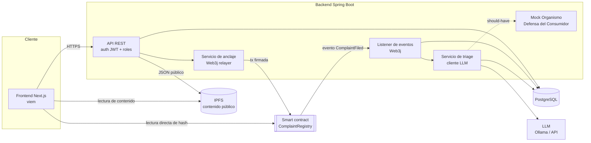
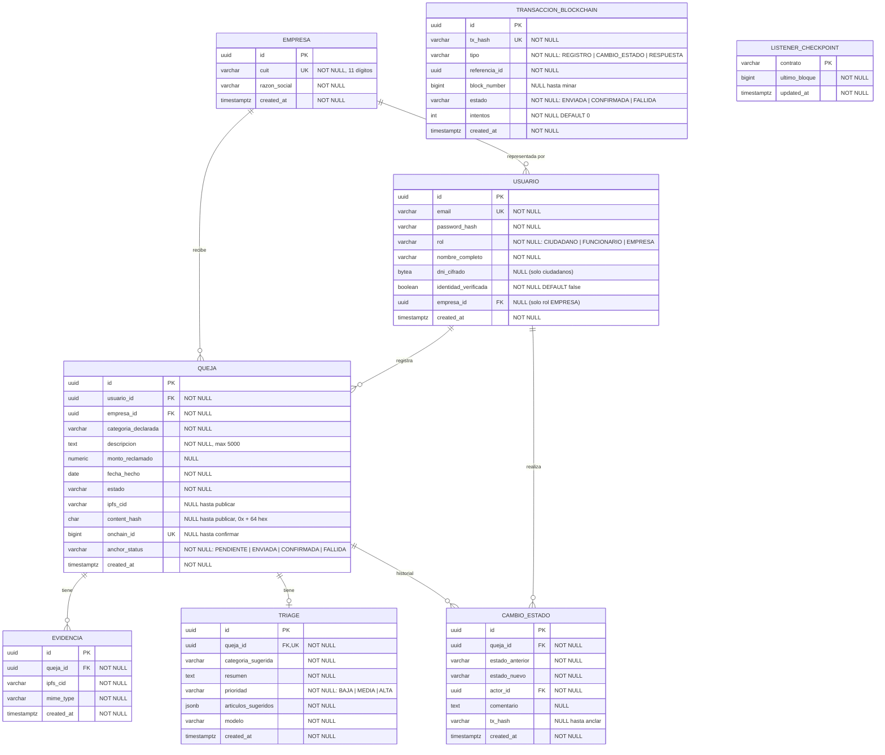

## Índice

0. [Ficha del proyecto](#0-ficha-del-proyecto)
1. [Descripción general del producto](#1-descripción-general-del-producto)
2. [Arquitectura del sistema](#2-arquitectura-del-sistema)
3. [Modelo de datos](#3-modelo-de-datos)
4. [Especificación de la API](#4-especificación-de-la-api)
5. [Historias de usuario](#5-historias-de-usuario)
6. [Tickets de trabajo](#6-tickets-de-trabajo)
7. [Pull requests](#7-pull-requests)

---

## 0. Ficha del proyecto

### **0.1. Tu nombre completo:**

Diego Alcorta

### **0.2. Nombre del proyecto:**

**LibroAbierto** — Libro de quejas de consumo verificable con anclaje en blockchain y triage asistido por IA.

### **0.3. Descripción breve del proyecto:**

LibroAbierto es un libro de quejas público para consumidores. Cada queja se registra en la base de datos del sistema y su contenido público se publica en IPFS, mientras que en una blockchain se ancla solo su huella criptográfica (hash). Así, nadie —ni la empresa denunciada ni el propio operador de la plataforma— puede alterar o borrar una queja sin que quede en evidencia.

Un servicio backend escucha los eventos on-chain, clasifica cada queja con un LLM (categoría, resumen, prioridad, normativa posiblemente involucrada) y la deja lista en un panel para el organismo de defensa del consumidor, cuyos cambios de estado también quedan anclados on-chain.

Los datos personales del denunciante **nunca** salen de la base de datos del backend: ni a IPFS ni a la blockchain.

### **0.4. URL del proyecto:**

_Pendiente (Entrega final)._

### 0.5. URL o archivo comprimido del repositorio

https://github.com/dalcorta/AI4Devs-finalproject/tree/feature/entrega-1-da

---

## 1. Descripción general del producto

### **1.1. Objetivo:**

**Problema.** Los canales actuales de reclamo de consumo son centralizados y opacos:
- El ciudadano no puede ver las quejas de otros consumidores contra la misma empresa.
- No hay garantía externa de que un reclamo no haya sido alterado u ocultado.
- El organismo recibe textos desestructurados que debe leer, clasificar y derivar a mano.

**Solución.** Un registro público y verificable de quejas que combina:
- **Integridad verificable:** el hash de cada queja y cada cambio de estado queda en blockchain, y cualquiera puede comprobar desde el navegador que el contenido publicado coincide.
- **Privacidad por diseño:** solo se publica la parte pública de la queja; los datos personales quedan en el backend, cumpliendo la [Ley 25.326 de Protección de Datos Personales](https://servicios.infoleg.gob.ar/infolegInternet/anexos/60000-64999/64790/texact.htm).
- **Triage con IA:** clasificación automática, resumen, prioridad y sugerencia de normativa de la [Ley 24.240 de Defensa del Consumidor](https://servicios.infoleg.gob.ar/infolegInternet/anexos/0-4999/638/texact.htm) para acelerar el trabajo del funcionario.

**Usuarios.**
| Rol | Necesidad |
|---|---|
| Ciudadano | Registrar una queja y que no pueda ser borrada ni alterada |
| Público general | Consultar el historial de quejas de una empresa y verificar su integridad |
| Funcionario del organismo | Recibir quejas ya clasificadas y priorizadas, y gestionar su estado |
| Empresa (should-have) | Responder públicamente a las quejas recibidas |

**Alcance del MVP.** La integración con sistemas estatales reales (MiBA, Trámites a Distancia de CABA) y la red Blockchain Federal Argentina (BFA) quedan fuera del MVP. La identidad y el organismo receptor se **simulan** y el contrato se despliega en una testnet pública. Ver [Roadmap](#roadmap-fuera-del-mvp).

### **1.2. Características y funcionalidades principales:**

**Must-have**
1. **Registro de queja** (HU-01): formulario, persistencia, publicación del contenido público en IPFS y anclaje del hash on-chain.
2. **Consulta pública y verificación de integridad** (HU-02): búsqueda por CUIT; verificación en el navegador del hash calculado contra el hash on-chain.
3. **Triage asistido por IA** (HU-03): un listener de eventos detecta la queja y un LLM devuelve un JSON estructurado con categoría, resumen, prioridad y artículos sugeridos.
4. **Gestión por el funcionario** (HU-04): panel con quejas priorizadas; cada cambio de estado se ancla on-chain.

**Should-have**
5. **Derecho a respuesta de la empresa** (HU-05): la empresa responde y la respuesta se publica y ancla igual que la queja.
6. **Detección de datos personales antes de publicar** (HU-06): el LLM revisa la descripción y advierte si contiene DNI, teléfonos, emails o nombres de terceros antes de que se publique de forma irreversible.

#### Roadmap (fuera del MVP)
- Integración con MiBA (OAuth2) y envío real a Trámites a Distancia de CABA.
- Migración a Blockchain Federal Argentina (BFA).
- Agrupamiento de reclamos similares (clustering por embeddings) para expedientes colectivos.
- Inferencia del LLM 100% on-premise para procesar datos privados.

### **1.3. Diseño y experiencia de usuario:**

_Pendiente (Entrega 2 / final): capturas y video del recorrido completo._

Pantallas previstas:
- `/` — buscador por CUIT o razón social.
- `/empresas/{cuit}` — listado público de quejas con badge de verificación.
- `/quejas/nueva` — formulario de queja (requiere login de ciudadano).
- `/quejas/{id}` — detalle público con historial de estados y enlaces a las transacciones.
- `/panel` — bandeja del funcionario ordenada por prioridad.

### **1.4. Instrucciones de instalación:**

_Pendiente (Entrega 2)._ Se prevé un único comando:

```bash
cp .env.example .env
docker compose up -d   # postgres, ipfs (kubo), anvil, ollama, backend, frontend
make deploy-contract   # despliega ComplaintRegistry en la cadena local
make seed              # usuarios y empresas de prueba
```

---

## 2. Arquitectura del Sistema

### **2.1. Diagrama de arquitectura:**



**Patrón.** Monolito modular en el backend con un flujo **orientado a eventos**: la blockchain actúa como log inmutable y el listener reacciona a sus eventos. El patrón es análogo a un *outbox* donde el registro de verdad sobre la integridad es la cadena.

**Por qué esta arquitectura.**
- **Blockchain como capa de anclaje, no como base de datos.** On-chain solo van hashes, CID, CUIT y estado. Es barato, rápido y evita publicar datos personales en un medio inmutable.
- **Verificación sin confiar en el backend.** El frontend lee el hash directamente del contrato y lo compara con el contenido que obtiene de IPFS. El usuario no depende de que el operador diga la verdad.
- **Relayer en el backend.** El backend firma las transacciones, así el ciudadano no necesita wallet ni cripto. Es el sacrificio de descentralización más relevante, y es aceptable porque el relayer solo puede **agregar** registros, nunca modificarlos ni borrarlos.
- **Monolito modular.** Para el MVP reduce la complejidad operativa frente a microservicios, y deja los módulos separados para extraerlos después.

**Sacrificios.**
- El relayer es un punto central de disponibilidad: si cae, no se registran quejas nuevas, aunque las existentes siguen verificables.
- La identidad del ciudadano es simulada en el MVP.
- La moderación de contenido ofensivo solo puede ocultar en el frontend; el registro on-chain persiste por diseño.

### **2.2. Descripción de componentes principales:**

| Componente | Tecnología | Responsabilidad |
|---|---|---|
| Smart contract `ComplaintRegistry` | Solidity 0.8.x, OpenZeppelin `AccessControl`, Foundry | Registrar quejas (hash, CID, CUIT), registrar cambios de estado, emitir eventos. Roles: `RELAYER_ROLE`, `OFFICER_ROLE`. |
| Frontend | Next.js (TypeScript), viem, Tailwind | Formularios, consulta pública, panel del funcionario y verificación de integridad en el navegador. |
| API REST | Spring Boot 3, Java 21, Spring Security (JWT) | Casos de uso, autenticación y autorización por rol, validación. |
| Servicio de anclaje | Web3j | Construye, firma y envía transacciones; guarda `tx_hash` y confirma bloques. |
| Listener | Web3j (suscripción a logs + checkpoint de bloque) | Detecta `ComplaintFiled` y `StatusChanged`; es idempotente y se recupera desde el último bloque procesado. |
| Servicio de triage | Spring AI (cliente compatible con Ollama/OpenAI) | Prompt de extracción con salida JSON validada contra un esquema; reintentos ante salidas inválidas. |
| Base de datos | PostgreSQL 16, Flyway | Datos de usuarios, quejas, triage, historial de estados y checkpoint del listener. |
| Almacenamiento público | IPFS (Kubo en local, Pinata en despliegue) | Documento JSON público de cada queja y evidencias públicas. |
| LLM | Ollama (Llama 3.x 8B) en local; proveedor por API en el despliegue | Solo procesa el **texto público** de la queja, nunca datos personales. |
| Mock organismo (should-have) | Módulo Spring | Simula la recepción de un expediente y devuelve un número de trámite. |

### **2.3. Descripción de alto nivel del proyecto y estructura de ficheros**

```
libroabierto/
├── contracts/                 # Foundry
│   ├── src/ComplaintRegistry.sol
│   ├── test/ComplaintRegistry.t.sol
│   └── script/Deploy.s.sol
├── backend/                   # Spring Boot, arquitectura hexagonal por módulo
│   └── src/main/java/.../
│       ├── complaint/         # dominio, casos de uso, adaptadores REST y JPA
│       ├── anchoring/         # puerto BlockchainGateway + adaptador Web3j
│       ├── listener/          # suscripción a eventos y checkpoint
│       ├── triage/            # puerto LlmClient + prompt y validación de salida
│       ├── identity/          # auth JWT, roles, mock de verificación de identidad
│       └── shared/            # hashing canónico (JCS + keccak256), config
├── frontend/                  # Next.js (app router)
│   ├── app/                   # páginas
│   ├── lib/verify.ts          # verificación de integridad en el navegador
│   └── tests/e2e/             # Playwright
├── docs/                      # diagramas, ADRs
├── docker-compose.yml
├── Readme.md
└── Prompts.md
```

El backend sigue una **arquitectura hexagonal** por módulo: el dominio no conoce Web3j ni el proveedor del LLM. Esto permite reemplazar la red (testnet → BFA) o el modelo (Ollama → API) cambiando solo el adaptador.

**Hash canónico.** El JSON público se serializa con JSON Canonicalization Scheme (RFC 8785) y se le aplica `keccak256`. Backend y frontend usan la misma canonicalización, así la verificación es reproducible.

### **2.4. Infraestructura y despliegue**

**Local (desarrollo):** `docker compose` con PostgreSQL, Kubo (IPFS), Anvil (cadena EVM local), Ollama, backend y frontend.

**Despliegue (Entrega final):**
| Pieza | Destino previsto |
|---|---|
| Smart contract | Testnet Polygon Amoy (BFA en roadmap) |
| Backend + PostgreSQL | Contenedor en un PaaS (Railway / Render / Fly.io) |
| Frontend | Vercel |
| IPFS | Pinata (pinning) |
| LLM | Proveedor por API (solo recibe texto ya público) |

**Pipeline CI (GitHub Actions):** `forge test` → tests del backend (con Testcontainers) → build del frontend → tests E2E con Playwright contra el entorno de docker compose.

### **2.5. Seguridad**

- **Minimización de datos:** DNI, nombre, email y teléfono solo viven en PostgreSQL. IPFS y la blockchain reciben únicamente contenido público y hashes. Esto evita publicar datos personales en un medio sin posibilidad de supresión.
- **Cifrado en reposo** de las columnas sensibles (DNI, teléfono) con una clave fuera del repositorio.
- **Clave privada del relayer** gestionada por variable de entorno o secret manager, nunca en el código. El rol `RELAYER_ROLE` solo permite **agregar** registros.
- **Control de acceso por roles** (CIUDADANO, FUNCIONARIO, EMPRESA) en la API y en el contrato (`OFFICER_ROLE` para cambios de estado).
- **Validación de entrada** (Bean Validation, validación de CUIT con dígito verificador, límites de tamaño de texto y archivos).
- **Mitigación de prompt injection:** el texto del usuario va delimitado como dato; la salida del LLM se valida contra un JSON Schema y se descarta si no cumple. El LLM no tiene herramientas ni acceso a datos privados.
- **Anti-spam:** límite de quejas por usuario por día y rate limiting por IP.
- **Datos de prueba:** el entorno de evaluación usa CUITs y personas ficticias.

### **2.6. Tests**

_Pendiente de implementación._ Estrategia prevista:
- **Contrato (Foundry):** registro de queja, rechazo sin rol, cambio de estado válido e inválido, emisión de eventos.
- **Unitarios backend (JUnit 5):** hashing canónico, validación de CUIT, parsing y validación de la salida del LLM, máquina de estados de la queja.
- **Integración (Testcontainers):** API + PostgreSQL + Anvil; el listener procesa un evento real y es idempotente ante eventos repetidos.
- **E2E (Playwright):** ciudadano registra una queja → aparece en la consulta pública con badge "verificada" → el funcionario la ve triageada y cambia su estado.

---

## 3. Modelo de Datos

### **3.1. Diagrama del modelo de datos:**



**Estado on-chain (`ComplaintRegistry`):**

```solidity
enum Status { REGISTRADA, EN_REVISION, DERIVADA, RESUELTA, DESESTIMADA }

struct Complaint {
    bytes32 contentHash;   // keccak256 del JSON público canonicalizado
    string  ipfsCid;       // CID del JSON público
    uint64  companyCuit;   // CUIT de la empresa (dato público)
    uint64  timestamp;
    Status  status;
}

event ComplaintFiled(uint256 indexed id, uint64 indexed companyCuit, bytes32 contentHash, string ipfsCid);
event StatusChanged(uint256 indexed id, Status previous, Status current, bytes32 noteHash);
```

### **3.2. Descripción de entidades principales:**

- **USUARIO:** persona que usa el sistema, con un rol. Contiene los únicos datos personales del sistema; el DNI se guarda cifrado. `identidad_verificada` simula la verificación con MiBA en el MVP.
- **EMPRESA:** entidad denunciada, identificada por su CUIT único (validado con dígito verificador).
- **QUEJA:** núcleo del dominio. Guarda la versión de trabajo de la queja y las referencias a su publicación (`ipfs_cid`, `content_hash`, `onchain_id`). `estado` sigue la máquina de estados `REGISTRADA → EN_REVISION → DERIVADA → RESUELTA | DESESTIMADA`.
- **EVIDENCIA:** archivos públicos adjuntos a una queja (fotos del producto, capturas), publicados en IPFS. Las facturas con datos personales no se publican.
- **TRIAGE:** resultado del LLM, en relación 1 a 1 con la queja. Guarda el modelo usado, para trazabilidad.
- **CAMBIO_ESTADO:** historial auditable de transiciones; cada una se ancla on-chain y guarda su `tx_hash`.
- **TRANSACCION_BLOCKCHAIN:** registro de las transacciones enviadas por el relayer, con reintentos y confirmación.
- **LISTENER_CHECKPOINT:** último bloque procesado por el listener, para recuperarse tras un reinicio sin perder ni duplicar eventos.

**Documento público en IPFS:**

```json
{
  "schema_version": "1.0",
  "empresa": { "cuit": "30712345678", "razon_social": "Empresa Ficticia S.A." },
  "queja": {
    "categoria": "telecomunicaciones",
    "descripcion": "Corte de servicio de internet durante 15 días sin respuesta del soporte.",
    "monto_reclamado_ars": 15000,
    "fecha_hecho": "2026-10-15"
  },
  "evidencias_cids": ["bafy..."],
  "registrada_en": "2026-10-18T12:00:00Z"
}
```

No contiene ningún dato del denunciante.

---

## 4. Especificación de la API

```yaml
openapi: 3.0.3
info:
  title: LibroAbierto API
  version: 0.1.0
paths:
  /api/quejas:
    post:
      summary: Registrar una queja (rol CIUDADANO)
      security: [{ bearerAuth: [] }]
      requestBody:
        required: true
        content:
          application/json:
            schema:
              type: object
              required: [cuitEmpresa, categoria, descripcion, fechaHecho]
              properties:
                cuitEmpresa: { type: string, pattern: '^\d{11}$' }
                razonSocial: { type: string }
                categoria: { type: string }
                descripcion: { type: string, maxLength: 5000 }
                montoReclamado: { type: number, minimum: 0 }
                fechaHecho: { type: string, format: date }
      responses:
        '202':
          description: Queja aceptada; el anclaje on-chain es asíncrono
          content:
            application/json:
              schema:
                type: object
                properties:
                  id: { type: string, format: uuid }
                  anchorStatus: { type: string, enum: [PENDIENTE] }
        '400': { description: Datos inválidos (p. ej. CUIT con dígito verificador incorrecto) }
        '401': { description: No autenticado }
        '429': { description: Límite diario de quejas alcanzado }

  /api/empresas/{cuit}/quejas:
    get:
      summary: Listado público de quejas de una empresa
      parameters:
        - { name: cuit, in: path, required: true, schema: { type: string } }
        - { name: page, in: query, schema: { type: integer, default: 0 } }
      responses:
        '200':
          description: Quejas públicas con datos de verificación
          content:
            application/json:
              schema:
                type: object
                properties:
                  items:
                    type: array
                    items:
                      type: object
                      properties:
                        id: { type: string, format: uuid }
                        onchainId: { type: integer }
                        ipfsCid: { type: string }
                        contentHash: { type: string }
                        estado: { type: string }
                        categoria: { type: string }
                        fechaHecho: { type: string, format: date }
        '404': { description: Empresa no encontrada }

  /api/quejas/{id}/estado:
    patch:
      summary: Cambiar el estado de una queja (rol FUNCIONARIO)
      security: [{ bearerAuth: [] }]
      parameters:
        - { name: id, in: path, required: true, schema: { type: string, format: uuid } }
      requestBody:
        required: true
        content:
          application/json:
            schema:
              type: object
              required: [estado]
              properties:
                estado: { type: string, enum: [EN_REVISION, DERIVADA, RESUELTA, DESESTIMADA] }
                comentario: { type: string, maxLength: 1000 }
      responses:
        '202': { description: Cambio aceptado; anclaje on-chain en curso }
        '403': { description: El usuario no tiene rol FUNCIONARIO }
        '409': { description: Transición de estado no permitida }

components:
  securitySchemes:
    bearerAuth: { type: http, scheme: bearer, bearerFormat: JWT }
```

---

## 5. Historias de Usuario

**Historia de Usuario 1 — HU-01: Registrar una queja** _(must-have)_

> **Como** ciudadano con identidad verificada,
> **quiero** registrar una queja contra una empresa,
> **para que** quede un registro público que nadie pueda borrar ni alterar.

Criterios de aceptación:
- **Dado** que estoy logueado como ciudadano verificado, **cuando** completo CUIT, categoría, descripción y fecha y envío el formulario, **entonces** el sistema responde con el identificador de la queja y estado de anclaje `PENDIENTE`.
- **Dado** un CUIT con dígito verificador inválido, **cuando** envío el formulario, **entonces** veo un error de validación y no se crea la queja.
- **Dada** una queja aceptada, **cuando** el anclaje se confirma, **entonces** el JSON público está en IPFS, su hash está registrado en el contrato y la queja pasa a `CONFIRMADA`.
- El JSON publicado **no** contiene nombre, DNI, email ni teléfono del denunciante.
- **Dado** que ya registré 5 quejas hoy, **cuando** intento registrar otra, **entonces** recibo un error de límite diario.

**Historia de Usuario 2 — HU-02: Consultar y verificar quejas de una empresa** _(must-have)_

> **Como** cualquier persona, sin necesidad de registrarme,
> **quiero** ver las quejas registradas contra una empresa y comprobar que no fueron alteradas,
> **para** tomar decisiones de consumo informadas sin depender de la palabra del operador.

Criterios de aceptación:
- **Cuando** busco por CUIT o razón social, **entonces** veo las quejas de esa empresa con categoría, fecha, estado y enlace a la transacción.
- **Cuando** abro una queja, **entonces** el navegador descarga el JSON de IPFS, calcula su hash canónico, lo compara con el hash leído directamente del contrato y muestra **"Verificada"** si coinciden.
- **Dado** que el contenido de IPFS no coincide con el hash on-chain, **entonces** se muestra **"Integridad comprometida"** de forma destacada.
- **Dada** una queja aún no confirmada on-chain, **entonces** se muestra como **"Pendiente de anclaje"**.

**Historia de Usuario 3 — HU-03: Triage automático con IA** _(must-have)_

> **Como** funcionario del organismo de defensa del consumidor,
> **quiero** que cada queja nueva llegue clasificada, resumida y priorizada,
> **para** atender primero los casos más graves sin leer cada texto completo.

Criterios de aceptación:
- **Cuando** el listener detecta un evento `ComplaintFiled`, **entonces** se genera un triage con categoría sugerida, resumen (máx. 3 líneas), prioridad (`BAJA | MEDIA | ALTA`) y artículos sugeridos de la Ley 24.240.
- La salida del LLM se valida contra un JSON Schema; si es inválida se reintenta hasta 2 veces y, si sigue fallando, la queja queda marcada como **"Triage manual"**.
- Si el mismo evento se recibe dos veces, se genera **un solo** triage (idempotencia).
- El LLM solo recibe el contenido público de la queja.
- El triage se muestra como **sugerencia**, identificada como generada por IA, y el funcionario puede ignorarla.

**Historia de Usuario 4 — HU-04: Gestionar el estado de una queja** _(must-have)_

> **Como** funcionario,
> **quiero** cambiar el estado de una queja desde un panel,
> **para que** el ciudadano y el público vean su avance de forma verificable.

Criterios de aceptación:
- El panel lista las quejas ordenadas por prioridad del triage y luego por antigüedad.
- Solo se permiten las transiciones de la máquina de estados; una transición inválida devuelve error.
- Cada cambio queda en el historial con actor, fecha, comentario y `tx_hash`.
- El nuevo estado se ve en la vista pública con su enlace a la transacción.

**Should-have**
- **HU-05 — Respuesta de la empresa:** un usuario con rol EMPRESA responde a una queja contra su CUIT; la respuesta se publica en IPFS y se ancla.
- **HU-06 — Detección de datos personales:** antes de publicar, el LLM analiza la descripción y, si detecta datos personales, avisa al ciudadano y le pide que los quite o confirme.

---

## 6. Tickets de Trabajo

**Ticket 1 — [DB] Esquema inicial y migraciones**

- **Tipo:** Base de datos · **HU:** HU-01, HU-02, HU-03, HU-04 · **Estimación:** 3 pts
- **Descripción:** crear el esquema de la sección 3 con migraciones Flyway.
- **Tareas:**
  - `V1__init.sql` con todas las tablas, PK, FK, `UNIQUE` (`empresa.cuit`, `queja.onchain_id`, `triage.queja_id`, `transaccion_blockchain.tx_hash`) y `CHECK` para los enums.
  - Índices: `queja(empresa_id, created_at DESC)`, `queja(estado)`, `triage(prioridad)`.
  - Configurar el cifrado de `dni_cifrado` con un `AttributeConverter` JPA y una clave por variable de entorno.
  - Script de seed con usuarios de prueba (ciudadano, funcionario, empresa) y 3 empresas ficticias.
- **Criterios de aceptación:** `flyway migrate` corre limpio sobre una base vacía; un test con Testcontainers verifica las restricciones (CUIT duplicado → error; triage duplicado → error).

**Ticket 2 — [Backend] Anclaje de queja y listener de eventos**

- **Tipo:** Backend · **HU:** HU-01, HU-03 · **Estimación:** 8 pts
- **Descripción:** implementar el flujo asíncrono desde `POST /api/quejas` hasta la confirmación on-chain y el procesamiento del evento.
- **Tareas:**
  - Caso de uso `RegistrarQueja`: valida, persiste con `anchor_status = PENDIENTE` y devuelve 202.
  - `JsonCanonicalizer` (RFC 8785) + `keccak256`, con tests de vectores conocidos compartidos con el frontend.
  - Adaptador IPFS: subida del JSON público y obtención del CID.
  - `BlockchainGateway` con Web3j: llamada a `fileComplaint`, registro en `transaccion_blockchain`, reintentos con backoff.
  - Listener: suscripción a `ComplaintFiled` desde `listener_checkpoint.ultimo_bloque`, actualización de `onchain_id` y disparo del triage. Idempotente.
- **Criterios de aceptación:** test de integración con Anvil donde se registra una queja, se confirma on-chain y el listener actualiza `onchain_id`; tras reiniciar el listener no se duplica el procesamiento.

**Ticket 3 — [Frontend] Vista pública con verificación de integridad**

- **Tipo:** Frontend · **HU:** HU-02 · **Estimación:** 5 pts
- **Descripción:** páginas `/empresas/{cuit}` y `/quejas/{id}` con verificación en el navegador.
- **Tareas:**
  - `lib/verify.ts`: descargar el JSON de IPFS, canonicalizarlo, calcular `keccak256` y leer `contentHash` del contrato con viem (sin pasar por el backend).
  - Badge de estado: Verificada / Pendiente de anclaje / Integridad comprometida.
  - Historial de estados con enlace al explorador de bloques.
  - Diseño responsive y estados de carga y error.
- **Criterios de aceptación:** test unitario de `verify.ts` con los mismos vectores que el backend; test E2E que manipula el contenido servido y comprueba que aparece "Integridad comprometida".

---

## 7. Pull Requests

_Pendiente (Entrega 2 y final)._

**Pull Request 1**

**Pull Request 2**

**Pull Request 3**
