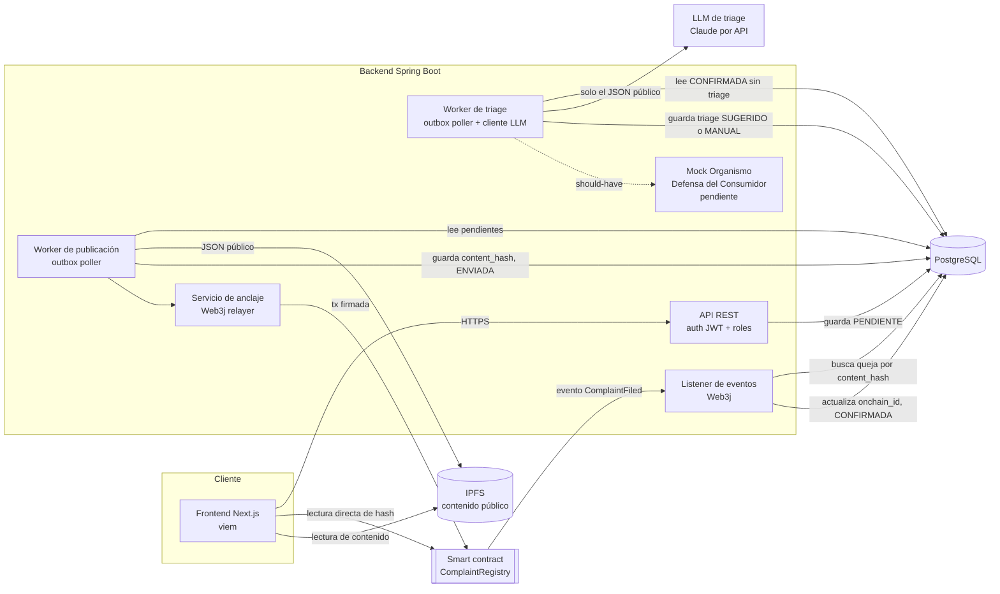
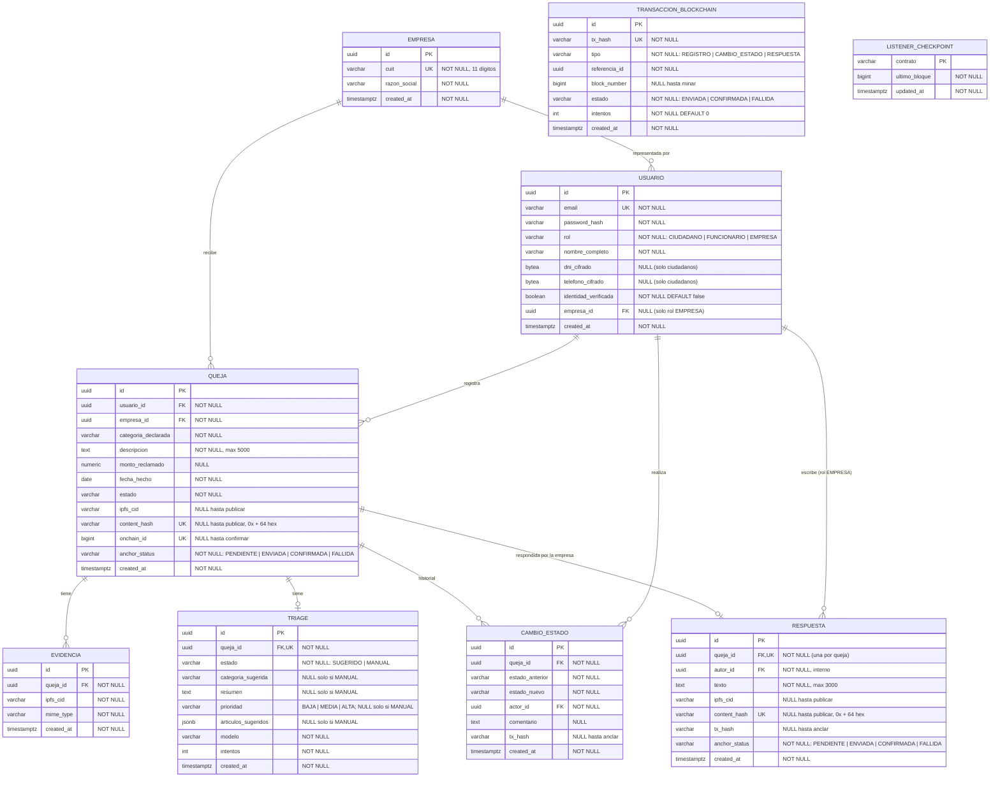

## Índice

0. [Ficha del proyecto](#0-ficha-del-proyecto)
1. [Descripción general del producto](#1-descripción-general-del-producto)
2. [Arquitectura del sistema](#2-arquitectura-del-sistema)
3. [Modelo de datos](#3-modelo-de-datos)
4. [Especificación de la API](#4-especificación-de-la-api)
5. [Historias de usuario](#5-historias-de-usuario)
6. [Tickets de trabajo](#6-tickets-de-trabajo)
7. [Pull requests](#7-pull-requests)

---

## 0. Ficha del proyecto

### **0.1. Tu nombre completo:**

Diego Alcorta

### **0.2. Nombre del proyecto:**

**LibroAbierto** — Libro de quejas de consumo verificable con anclaje en blockchain y triage asistido por IA.

### **0.3. Descripción breve del proyecto:**

LibroAbierto es un libro de quejas público para consumidores. Cada queja se registra en la base de datos del sistema y su contenido público se publica en IPFS, mientras que en una blockchain se ancla solo su huella criptográfica (hash). Así, nadie —ni la empresa denunciada ni el propio operador de la plataforma— puede alterar o borrar una queja sin que quede en evidencia.

Un servicio backend escucha los eventos on-chain, clasifica cada queja con un LLM (categoría, resumen, prioridad, normativa posiblemente involucrada) y la deja lista en un panel para el organismo de defensa del consumidor, cuyos cambios de estado también quedan anclados on-chain.

Los datos personales del denunciante **nunca** salen de la base de datos del backend: ni a IPFS ni a la blockchain.

### **0.4. URL del proyecto:**

_Pendiente (Entrega final)._

### 0.5. URL o archivo comprimido del repositorio

https://github.com/dalcorta/AI4Devs-finalproject/tree/feature/entrega-2-da

---

## 1. Descripción general del producto

### **1.1. Objetivo:**

**Problema.** Los canales actuales de reclamo de consumo son centralizados y opacos:
- El ciudadano no puede ver las quejas de otros consumidores contra la misma empresa.
- No hay garantía externa de que un reclamo no haya sido alterado u ocultado.
- El organismo recibe textos desestructurados que debe leer, clasificar y derivar a mano.

**Solución.** Un registro público y verificable de quejas que combina:
- **Integridad verificable:** el hash de cada queja y cada cambio de estado queda en blockchain, y cualquiera puede comprobar desde el navegador que el contenido publicado coincide.
- **Privacidad por diseño:** solo se publica la parte pública de la queja; los datos personales quedan en el backend, cumpliendo la [Ley 25.326 de Protección de Datos Personales](https://servicios.infoleg.gob.ar/infolegInternet/anexos/60000-64999/64790/texact.htm).
- **Triage con IA:** clasificación automática, resumen, prioridad y sugerencia de normativa de la [Ley 24.240 de Defensa del Consumidor](https://servicios.infoleg.gob.ar/infolegInternet/anexos/0-4999/638/texact.htm) para acelerar el trabajo del funcionario.

**Usuarios.**
| Rol | Necesidad |
|---|---|
| Ciudadano | Registrar una queja y que no pueda ser borrada ni alterada |
| Público general | Consultar el historial de quejas de una empresa y verificar su integridad |
| Funcionario del organismo | Recibir quejas ya clasificadas y priorizadas, y gestionar su estado |
| Empresa (should-have) | Responder públicamente a las quejas recibidas |

**Alcance del MVP.** La integración con sistemas estatales reales (MiBA, Trámites a Distancia de CABA) y la red Blockchain Federal Argentina (BFA) quedan fuera del MVP. La identidad y el organismo receptor se **simulan** y el contrato se despliega en una testnet pública. Ver [Roadmap](#roadmap-fuera-del-mvp).

### **1.2. Características y funcionalidades principales:**

**Must-have**
1. **Registro de queja** (HU-01): formulario, persistencia, publicación del contenido público en IPFS y anclaje del hash on-chain.
2. **Consulta pública y verificación de integridad** (HU-02): búsqueda por CUIT; verificación en el navegador del hash calculado contra el hash on-chain.
3. **Triage asistido por IA** (HU-03): un listener de eventos detecta la queja y un LLM devuelve un JSON estructurado con categoría, resumen, prioridad y artículos sugeridos.
4. **Gestión por el funcionario** (HU-04): panel con quejas priorizadas; cada cambio de estado se ancla on-chain.

**Should-have**
5. **Derecho a respuesta de la empresa** (HU-05): la empresa responde y la respuesta se publica y ancla igual que la queja.
6. **Detección de datos personales antes de publicar** (HU-06): el LLM revisa la descripción y advierte si contiene DNI, teléfonos, emails o nombres de terceros antes de que se publique de forma irreversible.

#### Roadmap (fuera del MVP)
- Integración con MiBA (OAuth2) y envío real a Trámites a Distancia de CABA.
- Migración a Blockchain Federal Argentina (BFA).
- Agrupamiento de reclamos similares (clustering por embeddings) para expedientes colectivos.
- Inferencia del LLM 100% on-premise para procesar datos privados.

### **1.3. Diseño y experiencia de usuario:**

_Pendiente (Entrega 2 / final): capturas y video del recorrido completo._

Pantallas previstas:
- `/` — buscador por CUIT o razón social.
- `/empresas/{cuit}` — listado público de quejas con badge de verificación.
- `/quejas/nueva` — formulario de queja (requiere login de ciudadano); antes de publicar avisa si la descripción parece tener datos personales (HU-06).
- `/quejas/{id}` — detalle público con historial de estados, enlaces a las transacciones y la respuesta de la empresa verificada.
- `/login` — ingreso de ciudadanos, funcionarios y representantes de empresa; cada rol va a su página.
- `/panel` — bandeja del funcionario ordenada por prioridad.
- `/empresa` — quejas recibidas por la empresa, con el formulario de respuesta pública (should-have).

### **1.4. Instrucciones de instalación:**

**Requisitos:** Docker o Podman (con `docker compose` o `podman-compose`), [Foundry](https://getfoundry.sh) 1.9, Java 21 con Maven y Node 22 o superior (Vitest 5 y jsdom 31 no corren en Node 20).

**1. Servicios locales** (PostgreSQL, Kubo y Anvil; los puertos quedan solo en 127.0.0.1):

```bash
docker compose up -d                  # o: podman-compose up -d
docker compose --profile pii up -d    # opcional, HU-06: agrega Ollama (~1,5 GB de RAM)
docker compose exec ollama ollama pull qwen2.5:1.5b   # solo la primera vez, si se usa el perfil pii
```

**2. Contrato.** Compilar y desplegar `ComplaintRegistry` en Anvil. Las claves son cuentas de prueba que Anvil imprime al arrancar (`docker compose logs anvil`): la cuenta 0 despliega y las cuentas 1 y 2 hacen de relayer y de funcionario.

```bash
cd contracts && git submodule update --init && npm install && forge build
PRIVATE_KEY=<clave cuenta 0> RELAYER_ADDR=<dirección cuenta 1> OFFICER_ADDR=<dirección cuenta 2> \
  forge script script/Deploy.s.sol --rpc-url http://127.0.0.1:8545 --broadcast
```

**3. Backend** (puerto 8081). Las variables sin valor por defecto son obligatorias; el resto está en `backend/src/main/resources/application.yml`.

```bash
cd backend
CONTRACT_ADDRESS=<dirección impresa por el deploy> \
RELAYER_PRIVATE_KEY=<clave cuenta 1> OFFICER_PRIVATE_KEY=<clave cuenta 2> \
JWT_SECRET=<32 bytes o más> \
ANTHROPIC_API_KEY=<clave> \
mvn spring-boot:run
```

Para trabajar sin LLM de triage, reemplazar `ANTHROPIC_API_KEY` por `TRIAGE_HABILITADO=false`. Sin el perfil `pii`, agregar `PII_LLM_HABILITADO=false`: la revisión de HU-06 usa solo patrones y pide confirmación siempre.

**4. Frontend** (puerto 3000):

```bash
cd frontend && cp .env.example .env.local   # ajustar NEXT_PUBLIC_CONTRACT_ADDRESS si no es la del primer deploy
npm install && npm run dev
```

**Usuarios de prueba.** _Pendiente:_ todavía no hay script de seed. Los E2E crean sus propios usuarios y empresas en una base aparte (`frontend/e2e/global-setup.ts`); para usar la aplicación a mano hay que insertar usuarios en la tabla `usuario` con la clave en BCrypt. Los comandos para correr los tests están en [2.6](#26-tests).

---

## 2. Arquitectura del Sistema

### **2.1. Diagrama de arquitectura:**



**Patrón.** Monolito modular en el backend con un flujo **orientado a eventos**: la blockchain actúa como log inmutable y el listener reacciona a sus eventos. Es un patrón **outbox**: `POST /api/quejas` solo persiste la queja en PostgreSQL con `anchor_status = PENDIENTE` y responde 202; un **worker de publicación** (poller en segundo plano) es quien de verdad sube el JSON a IPFS, calcula el `content_hash` y dispara la transacción, dejando la queja en `ENVIADA`. La clave de correlación entre el evento on-chain y la fila en PostgreSQL es el **`content_hash`** (único): el worker lo calcula y persiste *antes* de enviar la transacción, así que cuando el listener recibe `ComplaintFiled` —que trae el hash pero no el UUID interno— busca la queja por ese hash para completar `onchain_id` y pasarla a `CONFIRMADA`. El triage sigue el mismo patrón: un **worker de triage** toma las quejas `CONFIRMADA` que todavía no tienen triage, así que el listener no depende de que el LLM responda y una caída del proveedor no pierde ninguna queja.

**Por qué esta arquitectura.**
- **Blockchain como capa de anclaje, no como base de datos.** On-chain solo van hashes, CID, CUIT y estado. Es barato, rápido y evita publicar datos personales en un medio inmutable.
- **Verificación sin confiar en el backend.** El frontend lee el hash directamente del contrato y lo compara con el contenido que obtiene de IPFS. El usuario no depende de que el operador diga la verdad.
- **Relayer en el backend.** El backend firma las transacciones, así el ciudadano no necesita wallet ni cripto. Es el sacrificio de descentralización más relevante, y es aceptable porque el relayer solo puede **agregar** registros, nunca modificarlos ni borrarlos.
- **Monolito modular.** Para el MVP reduce la complejidad operativa frente a microservicios, y deja los módulos separados para extraerlos después.

**Sacrificios.**
- El relayer es un punto central de disponibilidad: si cae, no se registran quejas nuevas, aunque las existentes siguen verificables.
- La identidad del ciudadano es simulada en el MVP.
- La moderación de contenido ofensivo solo puede ocultar en el frontend; el registro on-chain persiste por diseño.

### **2.2. Descripción de componentes principales:**

| Componente | Tecnología | Responsabilidad |
|---|---|---|
| Smart contract `ComplaintRegistry` | Solidity 0.8.24, OpenZeppelin 5 `AccessControl`, Foundry | Registrar quejas (hash, CID, CUIT), cambios de estado y una respuesta de empresa por queja; emitir eventos. Roles: `RELAYER_ROLE`, `OFFICER_ROLE`. |
| Frontend | Next.js 16, React 19, TypeScript, viem; CSS propio (sin framework) | Formularios, consulta pública, paneles del funcionario y de la empresa, y verificación de integridad en el navegador. |
| API REST | Spring Boot 3.5, Java 21, Spring Security (JWT HS256) | Casos de uso, autenticación y autorización por rol, validación. Persiste la queja como `PENDIENTE`; no publica ni ancla de forma síncrona. |
| Worker de publicación | Spring `@Scheduled` (patrón outbox) | Toma quejas `PENDIENTE`, publica el JSON público en IPFS, calcula el `content_hash` canónico y dispara el anclaje. |
| Servicio de anclaje | Web3j | Construye, firma y envía transacciones; guarda `tx_hash` y confirma bloques. |
| Listener | Web3j (polling de `eth_getLogs` por lotes de bloques + checkpoint) | Detecta `ComplaintFiled`, `StatusChanged` y `ResponseFiled`; correlaciona el evento con la queja por `content_hash`; es idempotente y se recupera desde el último bloque procesado. |
| Servicio de triage | SDK oficial de Anthropic para Java (`anthropic-java`), modelo Claude, detrás del puerto `LlmClient` | Prompt de extracción con salida JSON validada contra un esquema y contra una lista cerrada de artículos de la Ley 24.240; reintentos ante salidas inválidas. |
| Base de datos | PostgreSQL 16, Flyway | Datos de usuarios, quejas, triage, historial de estados y checkpoint del listener. |
| Almacenamiento público | IPFS (Kubo en local, Pinata en despliegue) | Documento JSON público de cada queja y de cada respuesta de empresa. Las evidencias públicas están previstas pero no implementadas. |
| LLM (triage) | Proveedor por API en el despliegue (texto ya público, tras confirmar on-chain) | Clasifica, resume y prioriza. Solo procesa el **texto público** de la queja, nunca datos personales. |
| Detección de datos personales (should-have) | Patrones deterministas + Ollama local (`qwen2.5:1.5b` por defecto), siempre, sin importar el proveedor del triage | HU-06: revisa la descripción de la queja y el texto de la respuesta de la empresa **antes** de guardarlos, cuando todavía no son públicos; por eso el modelo corre siempre en local y la aplicación no arranca si su URL apunta fuera de la máquina o de la red privada. |
| Mock organismo (should-have, _pendiente_) | Módulo Spring | Simulará la recepción de un expediente y devolverá un número de trámite. Todavía no está implementado. |

### **2.3. Descripción de alto nivel del proyecto y estructura de ficheros**

```
libroabierto/
├── contracts/                 # Foundry
│   ├── src/ComplaintRegistry.sol
│   ├── test/ComplaintRegistry.t.sol
│   └── script/Deploy.s.sol
├── backend/                   # Spring Boot, arquitectura hexagonal por módulo
│   └── src/main/java/ar/libroabierto/
│       ├── complaint/         # dominio, casos de uso, adaptadores REST, JPA/JDBC e IPFS
│       ├── anchoring/         # puerto BlockchainGateway + adaptadores Web3j
│       ├── listener/          # lectura de eventos por polling y checkpoint
│       ├── triage/            # puerto LlmClient + prompt y validación de salida
│       ├── privacidad/        # detección de datos personales antes de publicar (HU-06)
│       ├── identity/          # login, JWT y roles
│       ├── config/            # configuración de Spring y propiedades
│       └── shared/            # hashing canónico (JCS + keccak256)
├── frontend/                  # Next.js (app router)
│   ├── app/                   # páginas
│   ├── components/            # badge de verificación y aviso de datos personales
│   ├── lib/verify.ts          # verificación de integridad en el navegador
│   ├── tests/                 # unitarios (Vitest)
│   └── e2e/                   # Playwright
├── shared/test-vectors/       # vectores del hash canónico, compartidos por backend y frontend
├── compose.yaml               # PostgreSQL, Kubo, Anvil y (perfil pii) Ollama para desarrollo local
├── CLAUDE.md                  # reglas para trabajar con IA en el repo
├── readme.md
└── prompts.md
```

El backend sigue una **arquitectura hexagonal** por módulo: el dominio no conoce Web3j ni el proveedor del LLM. Esto permite reemplazar la red (testnet → BFA) o el modelo (Ollama → API) cambiando solo el adaptador.

**Hash canónico.** El JSON público se serializa con JSON Canonicalization Scheme (RFC 8785) y se le aplica `keccak256`. Backend y frontend usan la misma canonicalización, así la verificación es reproducible.

### **2.4. Infraestructura y despliegue**

**Local (desarrollo):** `compose.yaml` levanta PostgreSQL, Kubo (IPFS) y Anvil (cadena EVM local), y Ollama con el perfil `pii`. El backend y el frontend corren fuera de compose (ver [1.4](#14-instrucciones-de-instalación)).

**Despliegue (Entrega final):**
| Pieza | Destino previsto |
|---|---|
| Smart contract | Testnet Polygon Amoy (BFA en roadmap) |
| Backend + PostgreSQL | Contenedor en un PaaS (Railway / Render / Fly.io) |
| Frontend | Vercel |
| IPFS | Pinata (pinning) |
| LLM | Proveedor por API (solo recibe texto ya público) |

**Pipeline CI (GitHub Actions, _pendiente_: todavía no hay workflow en el repo):** `forge test` → tests del backend (con Testcontainers) → build del frontend → tests E2E con Playwright contra el entorno de docker compose.

### **2.5. Seguridad**

- **Minimización de datos:** DNI, nombre, email y teléfono solo viven en PostgreSQL. IPFS y la blockchain reciben únicamente contenido público y hashes. Esto evita publicar datos personales en un medio sin posibilidad de supresión.
- **Cifrado en reposo** de las columnas sensibles (DNI, teléfono) con una clave fuera del repositorio. _Pendiente:_ las columnas `dni_cifrado` y `telefono_cifrado` existen, pero ningún flujo del MVP las escribe ni las lee (`UsuarioEntity` no las mapea), así que todavía no hay cifrado implementado.
- **Clave privada del relayer** gestionada por variable de entorno o secret manager, nunca en el código. El rol `RELAYER_ROLE` solo permite **agregar** registros.
- **Control de acceso por roles** (CIUDADANO, FUNCIONARIO, EMPRESA) en la API y en el contrato (`OFFICER_ROLE` para cambios de estado).
- **Validación de entrada** en los casos de uso (CUIT con dígito verificador, campos obligatorios, límites de tamaño de texto, montos y fechas), con errores por campo en la respuesta 400. La configuración se valida al arrancar con Bean Validation.
- **Detección de datos personales antes de publicar (HU-06):** patrones para DNI, CUIL, email, teléfono, tarjeta y CBU, y un modelo local (Ollama) para nombres de personas. Si el modelo no responde, se avisa igual y el autor confirma; nunca se da por limpio un texto que no se pudo revisar.
- **Mitigación de prompt injection:** el texto del usuario va delimitado como dato; la salida del LLM se valida contra un JSON Schema y se descarta si no cumple. El LLM no tiene herramientas ni acceso a datos privados.
- **Anti-spam:** límite de 5 quejas por usuario por día (respuesta 429). _Pendiente:_ rate limiting por IP.
- **Datos de prueba:** el entorno de evaluación usa CUITs y personas ficticias.

### **2.6. Tests**

| Suite | Herramienta | Qué cubre | Tests |
|---|---|---|---|
| Contrato | Foundry | Registro de queja, `contentHash` duplicado, rechazo sin rol, transiciones válidas e inválidas, respuesta única por queja, eventos | 16 |
| Backend | JUnit 5, Testcontainers (PostgreSQL, Kubo), Anvil real | Dominio (CUIT, máquina de estados, documento público), casos de uso, hash canónico con vectores compartidos, esquema Flyway, adaptadores Web3j, IPFS y Ollama, listener idempotente, triage con LLM simulado, API HTTP y un test de aceptación del recorrido completo (`PublicacionDeQuejaE2ETest`) | 310 |
| Frontend | Vitest | Hash canónico con los mismos vectores, verificación de queja y de respuesta, lectura del contrato contra un Anvil real, badge, aviso de datos personales | 59 |
| E2E | Playwright | Contra el entorno de compose: acceso por rol, queja nueva con aviso de datos personales, verificación, "Integridad comprometida" con contenido o hash manipulados, IPFS caído, cambio de estado del funcionario, respuesta de la empresa | 14 |

Todas pasan en la rama `feature/entrega-2-da` (0 fallos, 0 omitidos). Los tests nunca llaman al LLM real: usan un LLM simulado, un servidor HTTP local o `e2e/ollama-falso.mjs`.

```bash
cd contracts && forge build && forge test
cd backend && mvn test        # con Podman rootless: DOCKER_HOST=unix:///run/user/$(id -u)/podman/podman.sock
cd frontend && npm test && npm run typecheck && npm run build
cd frontend && npx playwright install chromium && npm run test:e2e   # requiere compose levantado y forge build
```

`forge build` va antes que los tests de backend y frontend que despliegan el contrato en Anvil. Al revisar resultados conviene mirar también la cantidad de tests por clase: sin Foundry instalado, las clases de Web3j del backend terminan con 0 tests ejecutados en vez de figurar como omitidas.

---

## 3. Modelo de Datos

### **3.1. Diagrama del modelo de datos:**



**Estado on-chain (`ComplaintRegistry`):**

```solidity
enum Status { REGISTRADA, EN_REVISION, DERIVADA, RESUELTA, DESESTIMADA }

struct Complaint {
    bytes32 contentHash;   // keccak256 del JSON público canonicalizado
    string  ipfsCid;       // CID del JSON público
    uint64  companyCuit;   // CUIT de la empresa (dato público)
    uint64  timestamp;
    Status  status;
}

struct Response {
    bytes32 contentHash;   // keccak256 del JSON público de la respuesta, canonicalizado
    string  ipfsCid;
    uint64  timestamp;
}

event ComplaintFiled(uint256 indexed id, uint64 indexed companyCuit, bytes32 contentHash, string ipfsCid);
event StatusChanged(uint256 indexed id, Status previous, Status current, bytes32 noteHash);
event ResponseFiled(uint256 indexed complaintId, bytes32 contentHash, string ipfsCid);

error ComplaintAlreadyFiled(bytes32 contentHash, uint256 existingId);
function complaintIdByHash(bytes32 contentHash) external view returns (uint256);

// HU-05: una sola respuesta por queja (RELAYER_ROLE), en cualquier estado.
error ResponseAlreadyFiled(uint256 complaintId);
error ResponseNotFound(uint256 complaintId);
function fileResponse(uint256 complaintId, bytes32 contentHash, string calldata ipfsCid) external;
function getResponse(uint256 complaintId) external view returns (Response memory);
function hasResponse(uint256 complaintId) external view returns (bool);
```

La respuesta de la empresa la firma también el relayer: la empresa no tiene clave on-chain y el backend comprueba, con su JWT, que quien responde representa a la empresa denunciada. El contrato guarda la respuesta por id de queja y rechaza una segunda; el adaptador Web3j busca el `ResponseFiled` de esa queja antes de enviar y, si ya está con el mismo hash, devuelve esa transacción.

`contentHash` es único on-chain: `fileComplaint` revierte si ya fue registrado. Como el backend correlaciona el evento con la queja por ese hash, esto impide que un reintento del relayer ancle la misma queja dos veces; el adaptador Web3j consulta `complaintIdByHash` antes de enviar y, si ya existe, devuelve la transacción original.

### **3.2. Descripción de entidades principales:**

- **USUARIO:** persona que usa el sistema, con un rol. Contiene los únicos datos personales del sistema; el DNI y el teléfono están previstos cifrados, pero ningún flujo del MVP los carga todavía (ver [2.5](#25-seguridad)). `identidad_verificada` simula la verificación con MiBA en el MVP.
- **EMPRESA:** entidad denunciada, identificada por su CUIT único (validado con dígito verificador).
- **QUEJA:** núcleo del dominio. Guarda la versión de trabajo de la queja y las referencias a su publicación (`ipfs_cid`, `content_hash`, `onchain_id`). `estado` sigue la máquina de estados `REGISTRADA → EN_REVISION → DERIVADA → RESUELTA | DESESTIMADA`. `content_hash` se calcula y persiste *antes* de enviar la transacción de anclaje, y es la clave que el listener usa para encontrar esta fila al recibir el evento `ComplaintFiled` (que no trae el UUID interno).
- **EVIDENCIA:** archivos públicos adjuntos a una queja (fotos del producto, capturas), publicados en IPFS. Las facturas con datos personales no se publican. _Pendiente:_ la tabla existe, pero todavía no hay endpoint para subir evidencias, así que `evidencias_cids` del documento público sale siempre vacío.
- **TRIAGE:** resultado del LLM, en relación 1 a 1 con la queja. Guarda el modelo usado y los intentos, para trazabilidad. En estado `MANUAL` ("Triage manual") ninguna salida del LLM pasó la validación tras los reintentos, y no lleva los campos sugeridos.
- **CAMBIO_ESTADO:** historial auditable de transiciones; cada una se ancla on-chain y guarda su `tx_hash`.
- **RESPUESTA:** respuesta pública de la empresa denunciada (HU-05), una por queja. Se publica y se ancla como la queja, con su propio `content_hash` para que el listener la encuentre al recibir `ResponseFiled`. `autor_id` (el usuario que respondió) es interno: no va a IPFS ni a la API pública.
- **TRANSACCION_BLOCKCHAIN:** registro de las transacciones enviadas por el relayer, con reintentos y confirmación.
- **LISTENER_CHECKPOINT:** último bloque procesado por el listener, para recuperarse tras un reinicio sin perder ni duplicar eventos.

**Documento público en IPFS:**

```json
{
  "schema_version": "1.0",
  "empresa": { "cuit": "30712345678", "razon_social": "Empresa Ficticia S.A." },
  "queja": {
    "categoria": "telecomunicaciones",
    "descripcion": "Corte de servicio de internet durante 15 días sin respuesta del soporte.",
    "monto_reclamado_ars": 15000,
    "fecha_hecho": "2026-10-15"
  },
  "evidencias_cids": ["bafy..."],
  "registrada_en": "2026-10-18T12:00:00Z"
}
```

No contiene ningún dato del denunciante.

**Respuesta pública de la empresa en IPFS** (HU-05):

```json
{
  "schema_version": "1.0",
  "tipo": "respuesta_empresa",
  "queja": { "onchain_id": 1, "content_hash": "0x6a6f...2d4b" },
  "empresa": { "cuit": "30712345678", "razon_social": "Empresa Ficticia S.A." },
  "respuesta": { "texto": "Restablecimos el servicio el 20/10 y acreditamos una bonificación por los días sin conexión." },
  "respondida_en": "2026-10-25T15:30:00Z"
}
```

La queja se referencia por su id y su hash on-chain, así la respuesta queda atada a la queja que responde. No lleva quién respondió. El ejemplo completo está en `shared/test-vectors/canonical-hash.json` (`respuesta_empresa_ejemplo`).

---

## 4. Especificación de la API

```yaml
openapi: 3.0.3
info:
  title: LibroAbierto API
  version: 0.1.0
paths:
  /api/auth/login:
    post:
      summary: Autenticar usuario y obtener token (acceso de ciudadano, funcionario o empresa)
      requestBody:
        required: true
        content:
          application/json:
            schema:
              type: object
              required: [email, password]
              properties:
                email: { type: string, format: email }
                password: { type: string }
      responses:
        '200':
          description: Autenticado
          content:
            application/json:
              schema:
                type: object
                properties:
                  token: { type: string }
                  rol: { type: string, enum: [CIUDADANO, FUNCIONARIO, EMPRESA] }
        '401': { description: Credenciales inválidas }

  /api/empresas:
    get:
      summary: Buscar empresas por CUIT o razón social (buscador de "/")
      parameters:
        - { name: q, in: query, required: true, schema: { type: string } }
      responses:
        '200':
          description: Empresas que coinciden con la búsqueda
          content:
            application/json:
              schema:
                type: array
                items:
                  type: object
                  properties:
                    cuit: { type: string }
                    razonSocial: { type: string }

  /api/quejas:
    post:
      summary: Registrar una queja (rol CIUDADANO)
      security: [{ bearerAuth: [] }]
      requestBody:
        required: true
        content:
          application/json:
            schema:
              type: object
              required: [cuitEmpresa, categoria, descripcion, fechaHecho]
              properties:
                cuitEmpresa: { type: string, pattern: '^\d{11}$' }
                razonSocial: { type: string }
                categoria: { type: string }
                descripcion: { type: string, maxLength: 5000 }
                montoReclamado: { type: number, minimum: 0 }
                fechaHecho: { type: string, format: date }
                confirmarDatosPersonales:
                  type: boolean
                  default: false
                  description: El ciudadano ya vio el aviso de HU-06 y publica la descripción tal cual
      responses:
        '202':
          description: Queja aceptada; el anclaje on-chain es asíncrono
          content:
            application/json:
              schema:
                type: object
                properties:
                  id: { type: string, format: uuid }
                  anchorStatus: { type: string, enum: [PENDIENTE] }
        '400': { description: Datos inválidos (p. ej. CUIT con dígito verificador incorrecto) }
        '401': { description: No autenticado }
        '403': { description: El usuario no es un ciudadano con identidad verificada }
        '422':
          description: >-
            HU-06: la descripción parece tener datos personales, o el modelo local no pudo revisarla, y no se confirmó.
            No se guarda nada; se reenvía corregida o con confirmarDatosPersonales en true
          content:
            application/json:
              schema: { $ref: '#/components/schemas/AvisoDeDatosPersonales' }
        '429': { description: Límite diario de quejas alcanzado }

  /api/quejas/{id}:
    get:
      summary: Detalle público de una queja
      parameters:
        - { name: id, in: path, required: true, schema: { type: string, format: uuid } }
      responses:
        '200':
          description: Detalle con contenido, historial de estados y evidencias
          content:
            application/json:
              schema:
                type: object
                properties:
                  id: { type: string, format: uuid }
                  onchainId: { type: integer }
                  ipfsCid: { type: string }
                  contentHash: { type: string }
                  estado: { type: string }
                  historialEstados:
                    type: array
                    items:
                      type: object
                      properties:
                        estadoAnterior: { type: string }
                        estadoNuevo: { type: string }
                        txHash: { type: string }
                        createdAt: { type: string, format: date-time }
                  evidenciasCids:
                    type: array
                    items: { type: string }
                  respuesta:
                    type: object
                    nullable: true
                    description: >-
                      Respuesta de la empresa, o null si no respondió. El texto no viaja acá: el navegador lo lee de
                      IPFS con el CID del contrato y lo verifica
                    properties:
                      anchorStatus: { type: string, enum: [PENDIENTE, ENVIADA, CONFIRMADA, FALLIDA] }
                      txHash: { type: string }
                      createdAt: { type: string, format: date-time }
        '404': { description: Queja no encontrada }

  /api/quejas/{id}/evidencias:
    post:
      summary: Adjuntar evidencia pública a una queja (rol CIUDADANO, dueño de la queja). PENDIENTE, no implementado
      description: Diseñado para el MVP pero todavía no implementado en el backend; hoy la ruta se rechaza, porque SeguridadConfig niega todo lo que no permite explícitamente
      security: [{ bearerAuth: [] }]
      parameters:
        - { name: id, in: path, required: true, schema: { type: string, format: uuid } }
      requestBody:
        required: true
        content:
          multipart/form-data:
            schema:
              type: object
              properties:
                archivo: { type: string, format: binary }
      responses:
        '201':
          description: Evidencia subida a IPFS
          content:
            application/json:
              schema:
                type: object
                properties:
                  ipfsCid: { type: string }
                  mimeType: { type: string }
        '403': { description: La queja no pertenece al usuario autenticado }
        '409': { description: La queja ya fue anclada; no admite nuevas evidencias }

  /api/empresas/{cuit}/quejas:
    get:
      summary: Listado público de quejas de una empresa
      parameters:
        - { name: cuit, in: path, required: true, schema: { type: string } }
        - { name: page, in: query, schema: { type: integer, default: 0 } }
      responses:
        '200':
          description: Quejas públicas con datos de verificación
          content:
            application/json:
              schema:
                type: object
                properties:
                  items:
                    type: array
                    items:
                      type: object
                      properties:
                        id: { type: string, format: uuid }
                        onchainId: { type: integer }
                        ipfsCid: { type: string }
                        contentHash: { type: string }
                        estado: { type: string }
                        categoria: { type: string }
                        fechaHecho: { type: string, format: date }
        '404': { description: Empresa no encontrada }

  /api/panel/quejas:
    get:
      summary: >-
        Bandeja del funcionario (solo quejas ancladas on-chain): primero las de triage manual, después por
        prioridad ALTA, MEDIA, BAJA, después las que esperan triage; dentro de cada grupo, la más antigua primero
      security: [{ bearerAuth: [] }]
      parameters:
        - { name: estado, in: query, schema: { type: string } }
        - { name: page, in: query, schema: { type: integer, default: 0 } }
      responses:
        '200':
          description: Quejas con su triage, ordenadas por prioridad y luego por antigüedad
          content:
            application/json:
              schema:
                type: object
                properties:
                  items:
                    type: array
                    items:
                      type: object
                      properties:
                        id: { type: string, format: uuid }
                        empresa: { type: string }
                        triageEstado: { type: string, enum: [SUGERIDO, MANUAL, PENDIENTE] }
                        categoriaSugerida: { type: string, description: Sugerencia generada por IA }
                        resumen: { type: string, description: Sugerencia generada por IA }
                        prioridad: { type: string, enum: [BAJA, MEDIA, ALTA] }
                        articulosSugeridos:
                          type: array
                          description: Artículos de la Ley 24.240 sugeridos por IA, de la lista cerrada
                          items: { type: string }
                        estado: { type: string }
                        createdAt: { type: string, format: date-time }
        '403': { description: El usuario no tiene rol FUNCIONARIO }

  /api/quejas/{id}/estado:
    patch:
      summary: Cambiar el estado de una queja (rol FUNCIONARIO)
      security: [{ bearerAuth: [] }]
      parameters:
        - { name: id, in: path, required: true, schema: { type: string, format: uuid } }
      requestBody:
        required: true
        content:
          application/json:
            schema:
              type: object
              required: [estado]
              properties:
                estado: { type: string, enum: [EN_REVISION, DERIVADA, RESUELTA, DESESTIMADA] }
                comentario: { type: string, maxLength: 1000 }
      responses:
        '202': { description: Cambio aceptado; anclaje on-chain en curso }
        '403': { description: El usuario no tiene rol FUNCIONARIO }
        '404': { description: Queja no encontrada }
        '409': { description: Transición de estado no permitida, o queja todavía no anclada on-chain }

  /api/empresa/quejas:
    get:
      summary: >-
        Quejas contra la empresa del usuario (rol EMPRESA): primero las ancladas sin responder, después de la más
        nueva a la más vieja. Nunca incluye quién se quejó
      security: [{ bearerAuth: [] }]
      parameters:
        - { name: page, in: query, schema: { type: integer, default: 0 } }
      responses:
        '200':
          description: La empresa y sus quejas recibidas
          content:
            application/json:
              schema:
                type: object
                properties:
                  empresa:
                    type: object
                    properties:
                      cuit: { type: string }
                      razonSocial: { type: string }
                  items:
                    type: array
                    items:
                      type: object
                      properties:
                        id: { type: string, format: uuid }
                        onchainId: { type: integer }
                        categoria: { type: string }
                        fechaHecho: { type: string, format: date }
                        estado: { type: string }
                        anclada: { type: boolean, description: Si ya se puede responder }
                        respuesta:
                          type: string
                          nullable: true
                          enum: [PENDIENTE, ENVIADA, CONFIRMADA, FALLIDA]
        '403': { description: El usuario no tiene rol EMPRESA }

  /api/quejas/{id}/respuesta:
    post:
      summary: Responder públicamente una queja contra la empresa del usuario (rol EMPRESA), una sola vez
      security: [{ bearerAuth: [] }]
      parameters:
        - { name: id, in: path, required: true, schema: { type: string, format: uuid } }
      requestBody:
        required: true
        content:
          application/json:
            schema:
              type: object
              required: [texto]
              properties:
                texto: { type: string, minLength: 1, maxLength: 3000 }
                confirmarDatosPersonales: { type: boolean, default: false }
      responses:
        '202':
          description: Respuesta aceptada; publicación en IPFS y anclaje on-chain en curso
          content:
            application/json:
              schema:
                type: object
                properties:
                  id: { type: string, format: uuid }
        '400': { description: Texto vacío o de más de 3000 caracteres }
        '403': { description: El usuario no tiene rol EMPRESA o no representa a la empresa denunciada }
        '404': { description: Queja no encontrada }
        '409': { description: La queja todavía no está anclada on-chain, o ya tiene una respuesta }
        '422':
          description: HU-06, igual que al registrar una queja (campo texto)
          content:
            application/json:
              schema: { $ref: '#/components/schemas/AvisoDeDatosPersonales' }

components:
  securitySchemes:
    bearerAuth: { type: http, scheme: bearer, bearerFormat: JWT }
  schemas:
    AvisoDeDatosPersonales:
      type: object
      properties:
        mensaje: { type: string }
        datosPersonales:
          type: object
          properties:
            campo: { type: string, enum: [descripcion, texto] }
            revisionCompleta:
              type: boolean
              description: false si el modelo local no respondió y solo se revisaron los patrones
            hallazgos:
              type: array
              description: Fragmentos del mismo texto enviado, para que el autor los encuentre; no se guardan
              items:
                type: object
                properties:
                  tipo: { type: string, enum: [NOMBRE, DNI, CUIL, EMAIL, TELEFONO, TARJETA, CBU] }
                  fragmento: { type: string }
                  inicio: { type: integer, description: Posición en el texto sin espacios al principio ni al final }
                  fin: { type: integer, description: Posición final, exclusiva }
```

---

## 5. Historias de Usuario

**Historia de Usuario 1 — HU-01: Registrar una queja** _(must-have)_

> **Como** ciudadano con identidad verificada,
> **quiero** registrar una queja contra una empresa,
> **para que** quede un registro público que nadie pueda borrar ni alterar.

Criterios de aceptación:
- **Dado** que estoy logueado como ciudadano verificado, **cuando** completo CUIT, categoría, descripción y fecha y envío el formulario, **entonces** el sistema responde con el identificador de la queja y estado de anclaje `PENDIENTE`.
- **Dado** un CUIT con dígito verificador inválido, **cuando** envío el formulario, **entonces** veo un error de validación y no se crea la queja.
- **Dada** una queja aceptada, **cuando** el anclaje se confirma, **entonces** el JSON público está en IPFS, su hash está registrado en el contrato y la queja pasa a `CONFIRMADA`.
- El JSON publicado **no** contiene nombre, DNI, email ni teléfono del denunciante.
- **Dado** que ya registré 5 quejas hoy, **cuando** intento registrar otra, **entonces** recibo un error de límite diario.

**Historia de Usuario 2 — HU-02: Consultar y verificar quejas de una empresa** _(must-have)_

> **Como** cualquier persona, sin necesidad de registrarme,
> **quiero** ver las quejas registradas contra una empresa y comprobar que no fueron alteradas,
> **para** tomar decisiones de consumo informadas sin depender de la palabra del operador.

Criterios de aceptación:
- **Cuando** busco por CUIT o razón social, **entonces** veo las quejas de esa empresa con categoría, fecha, estado y enlace a la transacción.
- **Cuando** abro una queja, **entonces** el navegador descarga el JSON de IPFS, calcula su hash canónico, lo compara con el hash leído directamente del contrato y muestra **"Verificada"** si coinciden.
- **Dado** que el contenido de IPFS no coincide con el hash on-chain, **entonces** se muestra **"Integridad comprometida"** de forma destacada.
- **Dada** una queja aún no confirmada on-chain, **entonces** se muestra como **"Pendiente de anclaje"**.

**Historia de Usuario 3 — HU-03: Triage automático con IA** _(must-have)_

> **Como** funcionario del organismo de defensa del consumidor,
> **quiero** que cada queja nueva llegue clasificada, resumida y priorizada,
> **para** atender primero los casos más graves sin leer cada texto completo.

Criterios de aceptación:
- **Cuando** el listener detecta un evento `ComplaintFiled`, **entonces** se genera un triage con categoría sugerida, resumen (máx. 3 líneas), prioridad (`BAJA | MEDIA | ALTA`) y artículos sugeridos de la Ley 24.240.
- La salida del LLM se valida contra un JSON Schema; si es inválida se reintenta hasta 2 veces y, si sigue fallando, la queja queda marcada como **"Triage manual"**.
- Si el mismo evento se recibe dos veces, se genera **un solo** triage (idempotencia).
- El LLM solo recibe el contenido público de la queja.
- El triage se muestra como **sugerencia**, identificada como generada por IA, y el funcionario puede ignorarla.

**Historia de Usuario 4 — HU-04: Gestionar el estado de una queja** _(must-have)_

> **Como** funcionario,
> **quiero** cambiar el estado de una queja desde un panel,
> **para que** el ciudadano y el público vean su avance de forma verificable.

Criterios de aceptación:
- El panel lista las quejas ordenadas por prioridad del triage y luego por antigüedad.
- Solo se permiten las transiciones de la máquina de estados; una transición inválida devuelve error.
- Cada cambio queda en el historial con actor, fecha, comentario y `tx_hash`.
- El nuevo estado se ve en la vista pública con su enlace a la transacción.
- El cambio se firma on-chain con una **clave institucional del funcionario** (`OFFICER_ROLE`), distinta de la del relayer: el backend autentica al funcionario con su JWT y guarda quién hizo el cambio; la cadena registra que lo hizo el organismo. On-chain va solo el hash del comentario (`noteHash`); el texto es interno.

**Should-have**
- **HU-05 — Respuesta de la empresa:** un usuario con rol EMPRESA responde a una queja contra su CUIT; la respuesta se publica en IPFS y se ancla.
  - Solo responde un representante de la empresa denunciada, una sola vez por queja (lo exigen la base y el contrato), y solo cuando la queja ya está anclada; el derecho a responder no vence con el estado de la queja.
  - La firma on-chain la hace el relayer; el documento público referencia el id y el hash on-chain de la queja y no lleva quién respondió.
  - La vista pública muestra la respuesta solo si su contenido se verifica en el navegador contra el contrato. La cadena manda: una respuesta anclada se muestra aunque el backend diga que no hay.
  - El formulario advierte que la respuesta es pública y permanente y que no debe incluir datos personales del consumidor. Desde HU-06, el texto pasa por la misma detección de datos personales que la descripción de una queja.
- **HU-06 — Detección de datos personales:** antes de publicar, el LLM analiza la descripción y, si detecta datos personales, avisa al ciudadano y le pide que los quite o confirme. Esta verificación corre **siempre con un modelo local (Ollama)**, nunca contra el proveedor por API usado para el triage post-publicación: en este punto la descripción todavía no es pública, así que no puede salir del backend.
  - Los datos con formato fijo (DNI, CUIL de persona, email, teléfono, tarjeta con Luhn, CBU) los encuentran patrones deterministas; el modelo local busca nombres de personas. Un nombre que el modelo devuelve y no aparece literalmente en el texto se descarta.
  - Si hay hallazgos y el autor no confirmó, la API responde 422 con cada fragmento y su posición, y no guarda nada. El autor corrige el texto o lo reenvía confirmando.
  - Si el modelo local no responde, los patrones corren igual y el 422 indica que la revisión quedó incompleta: el autor tiene que confirmar aunque no haya hallazgos.
  - Se aplica también a la respuesta de la empresa (HU-05).

---

## 6. Tickets de Trabajo

**Ticket 1 — [DB] Esquema inicial y migraciones**

- **Tipo:** Base de datos · **HU:** HU-01, HU-02, HU-03, HU-04 · **Estimación:** 3 pts
- **Descripción:** crear el esquema de la sección 3 con migraciones Flyway.
- **Tareas:**
  - `V1__init.sql` con todas las tablas, PK, FK, `UNIQUE` (`empresa.cuit`, `queja.onchain_id`, `queja.content_hash`, `triage.queja_id`, `transaccion_blockchain.tx_hash`) y `CHECK` para los enums.
  - Índices: `queja(empresa_id, created_at DESC)`, `queja(estado)`, `triage(prioridad)`.
  - Configurar el cifrado de `dni_cifrado` con un `AttributeConverter` JPA y una clave por variable de entorno. _Pendiente_ (ver [2.5](#25-seguridad)).
  - Script de seed con usuarios de prueba (ciudadano, funcionario, empresa) y 3 empresas ficticias. _Pendiente:_ por ahora solo los E2E crean usuarios de prueba, en su propia base.
- **Criterios de aceptación:** `flyway migrate` corre limpio sobre una base vacía; un test con Testcontainers verifica las restricciones (CUIT duplicado → error; triage duplicado → error).

**Ticket 2 — [Smart Contract] ComplaintRegistry**

- **Tipo:** Smart contract · **HU:** HU-01, HU-04 · **Estimación:** 5 pts
- **Descripción:** contrato Solidity que registra quejas y cambios de estado, con control de acceso por roles.
- **Tareas:**
  - `struct Complaint`, `enum Status` y las funciones `fileComplaint` (`RELAYER_ROLE`) y `changeStatus` (`OFFICER_ROLE`).
  - Eventos `ComplaintFiled` y `StatusChanged`.
  - `AccessControl` de OpenZeppelin para los roles; administración de roles restringida al admin.
  - Script de despliegue (`Deploy.s.sol`) parametrizado por red (local / testnet).
- **Criterios de aceptación (Foundry):** `fileComplaint` emite `ComplaintFiled` con los datos correctos; llamar `fileComplaint` o `changeStatus` sin el rol correspondiente revierte; una transición de estado inválida revierte; los tests cubren el camino feliz y los de rechazo.

**Ticket 3 — [Backend] Publicación y anclaje asíncrono de la queja**

- **Tipo:** Backend · **HU:** HU-01 · **Estimación:** 5 pts
- **Descripción:** desde `POST /api/quejas` hasta que la queja queda publicada en IPFS y la transacción de anclaje enviada (patrón outbox; ver [2.1](#21-diagrama-de-arquitectura)).
- **Tareas:**
  - Caso de uso `RegistrarQueja`: valida, persiste con `anchor_status = PENDIENTE` y devuelve 202.
  - `JsonCanonicalizer` (RFC 8785) + `keccak256`, con tests de vectores conocidos compartidos con el frontend.
  - Worker de publicación (`@Scheduled`, outbox): toma quejas `PENDIENTE`, sube el JSON público a IPFS, calcula y persiste `content_hash` (clave de correlación con el evento), pasa a `ENVIADA`.
  - `BlockchainGateway` con Web3j: llamada a `fileComplaint`, registro en `transaccion_blockchain`, reintentos con backoff.
- **Criterios de aceptación:** test de integración con Anvil donde una queja `PENDIENTE` termina en `ENVIADA` con su `content_hash` persistido y una transacción enviada; un fallo de IPFS o de la cadena no deja la queja en un estado inconsistente y el worker la reintenta.

**Ticket 4 — [Backend] Listener de eventos on-chain**

- **Tipo:** Backend · **HU:** HU-01, HU-03 · **Estimación:** 3 pts
- **Descripción:** procesar `ComplaintFiled` y `StatusChanged`, enlazarlos con la queja por `content_hash` y disparar el triage.
- **Tareas:**
  - Lectura periódica de eventos con `eth_getLogs` por lotes de bloques desde `listener_checkpoint.ultimo_bloque`, esperando un número configurable de confirmaciones. Se usa polling y no una suscripción por WebSocket: funciona con cualquier RPC HTTP, no pierde eventos si se corta la conexión y respeta el límite de rango de los RPC públicos.
  - Al recibir `ComplaintFiled`: buscar la queja por `content_hash` (único), actualizar `onchain_id` y `anchor_status = CONFIRMADA`.
  - Dejar la queja `CONFIRMADA` lista para el worker de triage (patrón outbox), sin llamar al LLM desde el listener.
  - Idempotencia: si `onchain_id` ya está seteado, no reprocesar el evento.
- **Criterios de aceptación:** test de integración con Anvil donde se emite un evento real y el listener actualiza la queja correcta por `content_hash`; al reenviar el mismo evento no se duplica el triage ni se reescribe el estado.

**Ticket 5 — [Backend] Servicio de triage con LLM**

- **Tipo:** Backend / IA · **HU:** HU-03 · **Estimación:** 5 pts
- **Descripción:** cliente LLM (SDK oficial de Anthropic, detrás del puerto `LlmClient`) que recibe el contenido público de una queja confirmada y devuelve categoría, resumen, prioridad y artículos sugeridos.
- **Tareas:**
  - Prompt de extracción con el texto público de la queja y una **lista cerrada** de artículos de la Ley 24.240 permitidos.
  - Validación de la salida contra JSON Schema; reintento hasta 2 veces ante salida inválida; descarte de cualquier artículo citado que no esté en la lista cerrada (mitiga alucinaciones).
  - Si tras los reintentos sigue fallando, marcar la queja como "Triage manual".
  - Persistencia en `TRIAGE` con el modelo usado y los intentos, para trazabilidad; "Triage manual" es `estado = MANUAL`.
  - Worker programado que toma las quejas `CONFIRMADA` sin triage; si el proveedor no responde, no guarda nada y la queja vuelve en la próxima pasada.
- **Criterios de aceptación:** test unitario con una salida de LLM simulada que cite un artículo fuera de la lista cerrada y se descarte; test de idempotencia (mismo evento → un solo triage); test del camino "Triage manual" tras 2 reintentos fallidos.

**Ticket 6 — [Frontend] Vista pública con verificación de integridad**

- **Tipo:** Frontend · **HU:** HU-02 · **Estimación:** 5 pts
- **Descripción:** páginas `/empresas/{cuit}` y `/quejas/{id}` con verificación en el navegador.
- **Tareas:**
  - `lib/verify.ts`: descargar el JSON de IPFS, canonicalizarlo, calcular `keccak256` y leer `contentHash` del contrato con viem (sin pasar por el backend).
  - Badge de estado: Verificada / Pendiente de anclaje / Integridad comprometida.
  - Historial de estados con enlace al explorador de bloques.
  - Diseño responsive y estados de carga y error.
- **Criterios de aceptación:** test unitario de `verify.ts` con los mismos vectores que el backend; test E2E que manipula el contenido servido y comprueba que aparece "Integridad comprometida".

**Ticket 7 — [Backend / IA] Detección de datos personales antes de publicar**

- **Tipo:** Backend / IA / Frontend · **HU:** HU-06, HU-05 · **Estimación:** 5 pts
- **Descripción:** revisar la descripción de la queja y el texto de la respuesta de la empresa antes de guardarlos, con patrones deterministas y un modelo local, y avisar al autor.
- **Tareas:**
  - Módulo `privacidad`: `DetectorDePatrones`, el puerto `ModeloLocal` con el adaptador `OllamaModeloLocal` (`/api/chat`, sin streaming, el JSON Schema como `format`, temperatura 0) y `RevisarDatosPersonales`, que valida la salida del modelo contra `privacidad/salida-nombres.schema.json` y ubica cada nombre en el texto.
  - `RegistrarQueja` y `ResponderQueja` revisan el texto si el pedido no trae `confirmarDatosPersonales`, después de las demás validaciones; la API responde 422 con los hallazgos.
  - `PrivacidadConfig` no arranca si `PII_OLLAMA_URL` apunta fuera de la máquina o de la red privada; con `PII_LLM_HABILITADO=false`, solo patrones y confirmación obligatoria.
  - Frontend: formulario `/quejas/nueva` y aviso con "Corregir el texto" y "Publicar igual", también en el formulario de respuesta de la empresa.
- **Criterios de aceptación:** tests unitarios de cada patrón (incluidos montos que no son DNI y CUIT de empresa que no es dato personal); un nombre inventado por el modelo se descarta; con el modelo caído se pide confirmación; test del adaptador contra un servidor HTTP local que imita Ollama; test HTTP del 422 y de la confirmación; E2E donde la ciudadana ve el aviso, corrige el texto y la queja termina verificada.

---

## 7. Pull Requests

_Pendiente (Entrega 2 y final)._

**Pull Request 1**

**Pull Request 2**

**Pull Request 3**
